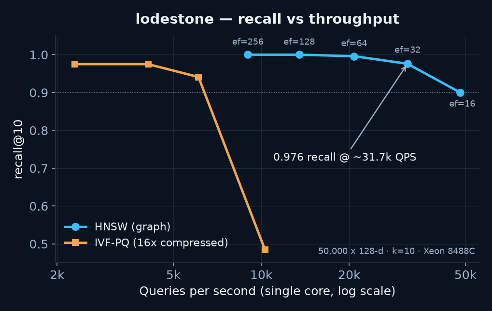

# lodestone

[](https://www.rust-lang.org/)
[](.github/workflows/ci.yml)
[](LICENSE)

A from-scratch **vector search engine** in Rust for embedding retrieval and
**RAG** workloads. It implements the two index families that back production
**approximate nearest neighbor (ANN)** systems — an **HNSW** proximity graph and
an **IVF-PQ** compressed inverted file — over **hand-written AVX-512 distance
kernels**, and measures search quality honestly on a **recall@k-vs-QPS** curve
against an exact brute-force oracle. No FAISS, no BLAS: the graph, product
quantizer, k-means, and SIMD kernels are all in-tree.

On 50,000 128-dimensional vectors, one machine, no GPU. HNSW and IVF-PQ query
throughput is measured on a single core, while the exact brute-force baseline the
speedups are taken against runs in parallel across all 48 vCPU. The two sides of
the ratio therefore do not use the same number of cores:

- **HNSW: 0.976 recall@10 at ~31,800 QPS** — about **33x** the exact
  brute-force search at that recall, and **9–33x** across the 90%+ recall band,
  reaching **1.000 recall@10** at higher `ef`.
- **IVF-PQ: 0.975 recall@10 with 16x-smaller vector codes** (product
  quantization + exact re-ranking of the ADC shortlist). The 16x is the PQ code
  size against a raw `f32` vector; this implementation also retains the
  full-precision vectors in memory to do the re-ranking, so it is not a 16x
  reduction in the index's resident footprint.
- **AVX-512 distance kernels** with runtime feature dispatch, differential-tested
  against a scalar reference — to a combined absolute+relative tolerance, not
  bit-for-bit — across a swept set of dimensions straddling the 16-lane boundary.
- **NEON distance kernels** for `aarch64` (Apple Silicon, AWS Graviton): on an
  Apple M3 Max they are **6.0–11.7x faster per distance call** than the scalar
  path across 128–1536 dimensions, cut HNSW construction from 30.3s to 8.9s, and
  raise single-core HNSW QPS 1.4–2.0x at identical recall
  ([Apple Silicon results](#apple-silicon-neon)).
- **Index persistence:** both index types save to a versioned, CRC-32-checked
  file. On 50,000 × 128-d vectors (M3 Max), HNSW reloads in **~90 ms versus
  9.4 s to rebuild** and IVF-PQ in **~72 ms versus ~3.9 s**; reloaded indexes
  answer bit-identically, and a reloaded HNSW index keeps growing exactly as the
  original would ([Persistence](#persistence)).

Every number here is read off the committed raw output in
[`benchmarks/raw/`](benchmarks/raw/), regenerated by the bench command in
[Quickstart](#quickstart). The recall figures are deterministic for the fixed
corpus and index seeds; the QPS figures are wall-clock timings and move between
runs on the same host. Numbers are single-host and CPU-specific; they are honest
measurements of this implementation on the disclosed hardware, not a claim
against a tuned production library.

## Why this exists

Retrieval infrastructure is the substrate under semantic search and RAG, and the
interesting engineering is the recall/latency/memory trade-off: an exact scan is
trivially 100% recall but scales linearly, so real systems approximate — and the
only honest way to talk about an ANN index is a **recall-vs-throughput curve
measured against exact ground truth**. This repository is built around that
measurement. The exact [`BruteForce`](src/index/brute.rs) index is the oracle;
`recall@k` for HNSW and IVF-PQ is defined as set overlap with its output, so the
quality numbers cannot be inflated.

## Results

Host: Intel Xeon Platinum 8488C (48 vCPU, AVX-512), `rustc` 1.95.0, built with
`-C target-cpu=native`, `avx512` backend selected at runtime. Corpus: 50,000 ×
128-d seeded clustered vectors (64 Gaussian clusters, σ=1), 1,000 held-out
queries, k=10, L2. Index parameters: HNSW `m=16`, `m0=32`, `ef_construction=200`;
IVF-PQ `nlist=256`, `m=32` subspaces of 256 centroids, exact re-ranking of a
`32 * k` shortlist, codebooks trained on 20,000 of the vectors. Query throughput
is single-threaded; the brute-force oracle is parallel over all 48 vCPU. HNSW
graph construction took 10.0s for the 50,000 vectors and is excluded from the QPS
figures. Full raw output:
[`benchmarks/raw/bench_50k_128d.txt`](benchmarks/raw/bench_50k_128d.txt).



### HNSW (graph index, `m=16`) — recall@10 vs QPS

| `ef` | recall@10 | QPS (1 core) |
|---:|---:|---:|
| 16  | 0.8996 | 47,335 |
| 32  | 0.9759 | 31,845 |
| 64  | 0.9964 | 20,946 |
| 128 | 1.0000 | 13,514 |
| 256 | 1.0000 |  8,898 |

The exact brute-force oracle sustains ~970 QPS scanning the full corpus in
parallel across the host's 48 vCPU. HNSW on **one** core matches that exact
recall (1.0000) at 8,898–13,514 QPS, and trades recall for throughput above
that: 0.9964 at 20,946 QPS and 0.8996 at 47,335 QPS.

### IVF-PQ (compressed index, `nlist=256`, `m=32`) — recall@10 vs QPS

| `nprobe` | recall@10 | QPS (1 core) |
|---:|---:|---:|
| 1  | 0.4850 |  9,797 |
| 4  | 0.9409 |  6,128 |
| 8  | 0.9748 |  4,110 |
| 16 | 0.9747 |  2,305 |
| 32 | 0.9747 |  1,229 |

Product quantization codes each 128-d vector into 32 bytes instead of 512
(**16x smaller** — `compression_ratio()` reports `16.0x` in the raw output);
the top-k is then re-scored with exact full-precision distances over an ADC
shortlist of `32 * k` candidates (320 at `k=10`). This repository does not
measure the pure-ADC ranking, so the recall that re-ranking recovers relative to
un-re-ranked PQ is not quantified here — `set_rerank_factor(0)` in
[`ivfpq.rs`](src/index/ivfpq.rs) exposes that comparison but no committed run
uses it.

`nprobe` bounds how many of the 256 inverted-list cells are scanned. Recall
climbs to 0.9748 at `nprobe=8` and then flattens — `nprobe=16` and `32` buy no
additional recall (0.9747, a hair lower) while dropping throughput by 1.8x and
3.3x, so on this corpus `nprobe=8` is the knee. At `nprobe=1` only 1 of 256 cells
is visited, so most true neighbors are never candidates and recall falls to
0.4850.

### Apple Silicon (NEON)

Host: Apple M3 Max (14 cores), macOS 27, `rustc` 1.94.1, built with
`-C target-cpu=native`. Same corpus, queries, seeds, and index parameters as
above. The scalar rows force the portable kernels with
`LODESTONE_FORCE_SCALAR=1` on the same host, so the only difference between the
two columns is the distance backend. Raw output:
[`kernels_apple_m3max.txt`](benchmarks/raw/kernels_apple_m3max.txt),
[`bench_50k_128d_apple_m3max_neon.txt`](benchmarks/raw/bench_50k_128d_apple_m3max_neon.txt),
[`bench_50k_128d_apple_m3max_scalar.txt`](benchmarks/raw/bench_50k_128d_apple_m3max_scalar.txt).

**Kernel cost** (`lodestone-kernels`: one query against a 64-vector pool that
stays in cache, best of 5 runs of 200 ms; it measures the arithmetic, not
memory bandwidth):

| metric | dim | scalar (ns/call) | NEON (ns/call) | speedup |
|---|---:|---:|---:|---:|
| L2 | 128  | 50.2   | 7.3  | 6.9x  |
| L2 | 384  | 202.6  | 21.4 | 9.5x  |
| L2 | 768  | 502.3  | 47.9 | 10.5x |
| L2 | 1536 | 1081.9 | 92.4 | 11.7x |
| IP | 128  | 43.2   | 7.2  | 6.0x  |
| IP | 384  | 183.4  | 19.6 | 9.4x  |
| IP | 768  | 486.6  | 49.9 | 9.8x  |
| IP | 1536 | 1057.9 | 91.3 | 11.6x |

The scalar loop is one serial chain of dependent adds (the compiler may not
reorder float additions), so it runs at the latency of one add per element. The
NEON kernel keeps four independent 4-lane accumulators, 16 floats per iteration,
so the gap widens with dimension.

**End to end** (50,000 × 128-d, single-core queries):

| | scalar | NEON | change |
|---|---:|---:|---:|
| HNSW build (50,000 inserts) | 30.3s | 8.9s | 3.4x faster |
| HNSW `ef=32`: recall@10 / QPS | 0.9759 / 12,974 | 0.9759 / 25,078 | 1.93x QPS |
| HNSW `ef=128`: recall@10 / QPS | 1.0000 / 7,103 | 1.0000 / 11,235 | 1.58x QPS |
| IVF-PQ `nprobe=8`: recall@10 / QPS | 0.9748 / 5,555 | 0.9748 / 6,934 | 1.25x QPS |

Recall is identical across backends at every `ef` and `nprobe` in the raw
output, as it should be: the kernels change how fast distances are computed,
not which neighbors are found. End-to-end gains are smaller than the kernel
gains because search also spends time on graph traversal, heap operations, and
(for IVF-PQ) table lookups that the kernels do not touch. These M3 Max QPS
figures are not comparable to the Xeon table above: different CPU, and a
different oracle core count.

### Persistence

`Hnsw::save` / `Hnsw::load` store the vectors, graph, and construction
parameters; `IvfPq::save` / `IvfPq::load` store the coarse centroids, PQ
codebooks, posting lists, and the full-precision vectors used for re-ranking.
Same corpus and parameters as above, Apple M3 Max, 3 runs
([raw](benchmarks/raw/persistence_apple_m3max.txt)):

| | build from scratch | `save` | `load` | file |
|---|---:|---:|---:|---:|
| HNSW (50,000 inserts) | 9.4 s | 108–112 ms | 89–93 ms | 32.4 MiB |
| IVF-PQ (train on 20,000 + 50,000 adds) | 3.9–4.0 s | 91–100 ms | 71–75 ms | 26.4 MiB |

`save` includes the fsync and atomic rename. After each `load`, the benchmark
checks that all 1,000 queries return identical results from the original and
the reloaded index. (HNSW build time varies between sessions on this host: 8.0–
8.9 s in an earlier run of the same command.)

**File format** ([`src/persist.rs`](src/persist.rs)): an 8-byte magic, a format
version, a little-endian body, and a CRC-32 over everything before it. `save`
writes a temporary sibling, fsyncs it, and renames it into place, so a crash
mid-save leaves the previous file intact. `load` checks the magic, version, and
checksum, then every structural invariant — vector count, one link slot per
node per layer, neighbor ids in range, levels consistent with the layer count,
entry point on the top layer — so a damaged file returns an error instead of a
panic or wrong neighbors. Construction draws exactly one random level per
insert, so `load` replays that many draws to restore the generator: inserting
after a reload builds the same graph, byte for byte, as never saving at all.

Tests ([`tests/persistence.rs`](tests/persistence.rs), and unit tests in
[`hnsw.rs`](src/index/hnsw.rs)): bit-exact search results after a round trip for
both metrics; 500 inserts after a reload producing a byte-identical file to the
never-saved index (removing the generator replay makes this fail); a bit flip at
~100 positions, truncation, and a foreign file all rejected; and five
checksum-valid but structurally invalid files rejected as corrupt. For IVF-PQ:
a bit-exact round trip for both metrics at several `nprobe` values, bit flips
and truncation rejected, an HNSW file rejected as the wrong type, and duplicate
or missing postings, wrong code lengths, and a short re-rank store all rejected
as corrupt. IVF-PQ `load` checks that every vector id appears in exactly one
posting list, since search and re-ranking index the full-precision store by id.

## How it works

```
                                  query
                                    │
              ┌─────────────────────┼──────────────────────┐
              ▼                     ▼                       ▼
        BruteForce              HNSW graph              IVF-PQ
        (exact oracle)     ┌──────────────────┐   ┌──────────────────────┐
              │            │ upper layers:     │   │ coarse quantizer:     │
    parallel full scan     │  greedy descent   │   │  nprobe nearest cells │
      → exact top-k        │ layer 0:          │   │ posting lists:        │
        (ground truth      │  ef-beam search   │   │  PQ codes (m bytes)   │
         for recall@k)     │ heuristic         │   │  → ADC shortlist      │
                           │  neighbor select  │   │  → exact re-rank      │
                           └──────────────────┘   └──────────────────────┘
                                    │                       │
                                    └──────────┬────────────┘
                                               ▼
                         AVX-512 / NEON L2 / inner-product kernels
                              (runtime dispatch, scalar oracle fallback)
```

- **[`distance`](src/distance/)** — L2 and inner-product kernels. On `x86_64`
  the AVX-512 path processes 16 `f32` lanes per fused-multiply-add with a masked
  tail load for any dimension, selected once via `is_x86_feature_detected!`. On
  `aarch64` the NEON path runs four independent 4-lane fused-multiply-add
  accumulators, then a 4-lane loop and a scalar loop for the tail. The scalar
  path is the differential-test oracle; setting `LODESTONE_FORCE_SCALAR=1`
  selects it at runtime for benchmarking.
- **[`index::Hnsw`](src/index/hnsw.rs)** — Malkov & Yashunin (2018): multi-layer
  proximity graph, exponentially-decaying level assignment, greedy descent
  through upper layers, `ef`-width beam search on layer 0, and the paper's
  neighbor-selection heuristic (Algorithm 4) — which prunes links to candidates
  already covered by a kept neighbor, the paper's mechanism for keeping the graph
  navigable on clustered data. Plain nearest-M is not implemented here, so this
  repository does not measure the difference between the two.
- **[`index::IvfPq`](src/index/ivfpq.rs)** + **[`quant::ProductQuantizer`](src/quant/pq.rs)**
  — Jégou et al. (2011): coarse k-means quantizer feeding inverted lists of PQ
  codes, Asymmetric Distance Computation (ADC) via a per-query lookup table, and
  optional exact re-ranking of the shortlist.

## Quickstart

Requirements: Rust 1.89 or newer (the committed runs used `rustc` 1.95.0 on the
Xeon and 1.94.1 on the M3 Max). The SIMD backend is auto-detected at runtime:
AVX-512 on `x86_64`, NEON on `aarch64`. On an `x86_64` host without AVX-512 the
scalar kernels are used and every test still passes — but the differential test
then compares the scalar path against itself, so it only proves anything about
a SIMD backend on a host that has one. `backend_name()` prints which path was
selected.

```sh
git clone https://github.com/iwang-1/lodestone.git
cd lodestone

# Unit + differential (SIMD vs scalar) + recall tests.
cargo test --release

# Per-call kernel cost, scalar vs this host's SIMD backend.
RUSTFLAGS="-C target-cpu=native" cargo run --release --bin lodestone-kernels

# Regenerate the results tables (HNSW graph construction alone was 10.0s in the
# committed run). Recall values reproduce exactly for these seeds; QPS is
# wall-clock and will differ on your host.
RUSTFLAGS="-C target-cpu=native" cargo run --release --bin lodestone-bench -- \
    --n 50000 --dim 128 --queries 1000 --k 10

# The same benchmark with the SIMD backend disabled, for a same-host comparison.
LODESTONE_FORCE_SCALAR=1 RUSTFLAGS="-C target-cpu=native" \
    cargo run --release --bin lodestone-bench
```

Library use:

```rust
use lodestone::index::{Hnsw, HnswParams};
use lodestone::Metric;

let mut index = Hnsw::new(128, Metric::L2, HnswParams::new(16));
for v in &vectors {
    index.insert(v);           // v: &[f32] of length 128
}
// top-10 approximate neighbors; ef trades recall for latency.
let hits: Vec<(u32, f32)> = index.search(&query, 10, 64);
```

## Correctness evidence

To run the two regression targets independently:

```sh
cargo test --locked --release --test recall
cargo test --locked --release --test differential
```

Use the first when changing index traversal or re-ranking. Use the second when changing distance kernels, on an AVX-512 or `aarch64` host to exercise that hardware path.

- **Differential SIMD test** ([`tests/differential.rs`](tests/differential.rs)):
  for both metrics, the host's SIMD kernels (AVX-512 or NEON) agree with the
  scalar reference over 200 random vector pairs at each of 17 dimensions chosen
  to straddle the 4- and 16-lane boundaries and exercise every tail path (1, 2,
  3, 4, 5, 7, 15, 16, 17, 19, 31, 33, 64, 96, 127, 128, 768) — a swept set, not
  every dimension. On `aarch64` a separate test asserts that the NEON backend
  was actually selected, so the comparison cannot silently degrade to scalar
  against scalar. Agreement is under a
  combined tolerance (`atol=1e-3`, `rtol=1e-4`), not exact equality: scalar
  accumulates sequentially while the SIMD path does a tree reduction, so the two
  differ in the last bits by floating-point non-associativity.
- **Recall regression test** ([`tests/recall.rs`](tests/recall.rs)): on a 5,000 ×
  64-d seeded corpus, HNSW at `ef=200` is asserted to recover >90% of the exact
  top-10, and IVF-PQ with re-ranking scanning all cells >55%. These are loose
  regression floors against the brute-force oracle, not the headline numbers
  above; the >55% floor in particular is far below the 0.9748 the benchmark
  measures.
- **CI** ([`.github/workflows/ci.yml`](.github/workflows/ci.yml)) runs
  `cargo fmt --check`, `cargo clippy --all-targets -D warnings`,
  `cargo test --release`, and a smoke run of `lodestone-kernels` on
  `ubuntu-latest` and `macos-latest`. The macOS runner is Apple Silicon, so CI
  exercises the NEON kernels on every push. GitHub's `x86_64` runners are not
  guaranteed to expose AVX-512, so CI generally exercises the scalar path there;
  the AVX-512 kernels are covered by running the same tests on an AVX-512 host.

## Design boundaries

- Both indexes save and load whole files ([Persistence](#persistence)); there
  is no incremental on-disk update and no mmap, so `load` reads the full file into
  memory. IVF-PQ keeps the full-precision vectors resident (and in its file) to
  re-rank the ADC shortlist.
- Incremental insert *is* supported ([`Hnsw::insert`](src/index/hnsw.rs),
  [`IvfPq::add`](src/index/ivfpq.rs) after `train`), but there is no delete,
  update, or compaction, and no concurrent writers — inserts take `&mut self`
  with no interior locking, so writes are exclusive by construction. `IvfPq::add`
  further requires densely increasing ids because the re-rank store is indexed
  by id.
- Benchmarks use a seeded synthetic clustered corpus (a Gaussian mixture, which
  mirrors real embedding cluster structure) so runs are reproducible without an
  external download. Query throughput is single-host and single-core (the exact
  oracle is the one parallel component) and must not be compared to a
  distributed vector database.
- k-means uses random-sample seeding rather than k-means++, and a fixed
  iteration budget (15 for the PQ codebooks, 10 for the coarse quantizer, each
  with early exit on a stable assignment); codebook quality — and thus IVF-PQ
  recall — is bounded by that choice.
- The `ef=128` and `ef=256` rows report recall@10 of exactly 1.0000 against the
  oracle on this corpus. That is a measurement on 1,000 queries over 50,000
  seeded clustered vectors, not a guarantee: HNSW is approximate and gives no
  exactness bound.
- The figure in [Results](#results) is a committed PNG rendered from the raw
  benchmark output; the plotting script is not in the repository, so the raw text
  file is the authoritative artifact.

## Repository map

| Path | Responsibility |
|---|---|
| `src/distance/` | L2 / inner-product kernels: AVX-512, NEON, scalar oracle |
| `src/index/brute.rs` | Exact parallel scan (recall ground truth) |
| `src/index/hnsw.rs` | HNSW graph index |
| `src/index/ivfpq.rs` | IVF-PQ compressed inverted file + re-ranking |
| `src/quant/pq.rs` | Product quantizer, k-means, ADC |
| `src/eval.rs` | recall@k against the oracle |
| `src/dataset.rs` | Seeded reproducible clustered corpora |
| `src/bin/bench.rs` | Recall-vs-QPS benchmark harness |
| `src/bin/kernels.rs` | Per-call kernel cost, scalar vs SIMD |
| `src/persist.rs` | Index file format: magic, version, CRC-32, atomic write |
| `tests/` | Differential SIMD, recall regression, and persistence tests |
| `benchmarks/raw/` | Committed raw benchmark output |

License: [MIT](LICENSE)
